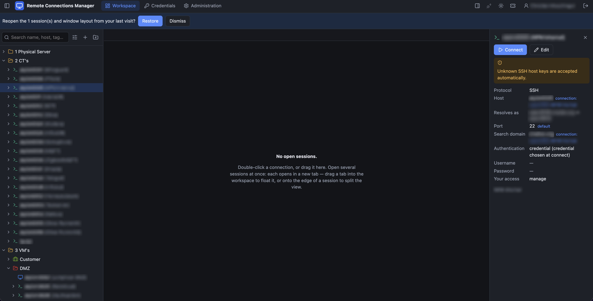
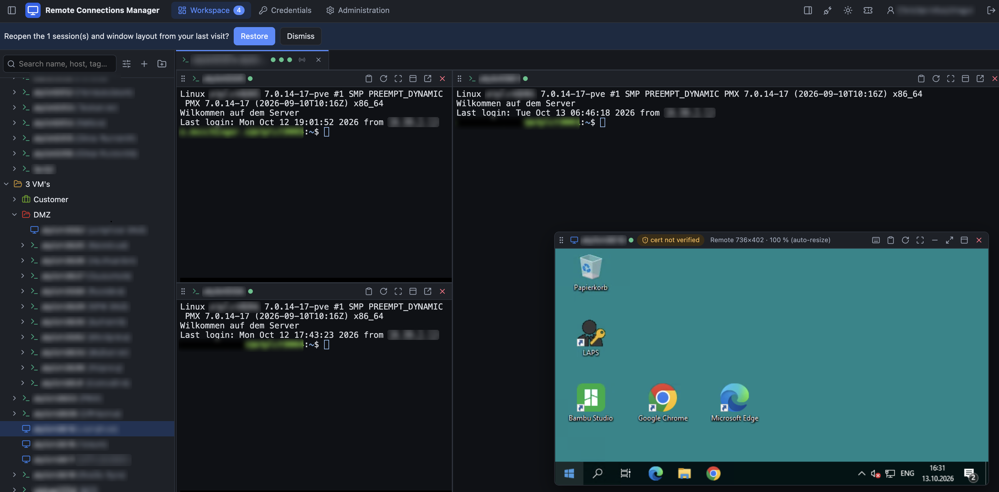
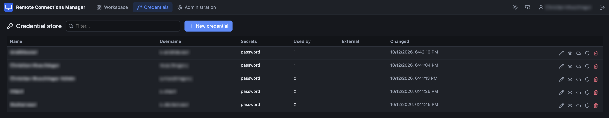
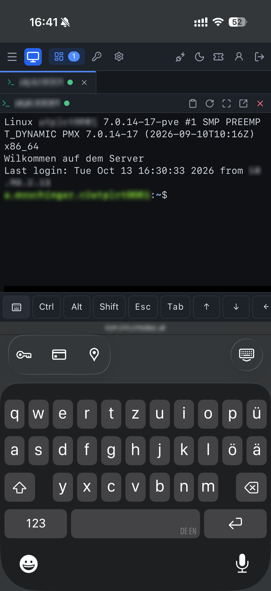
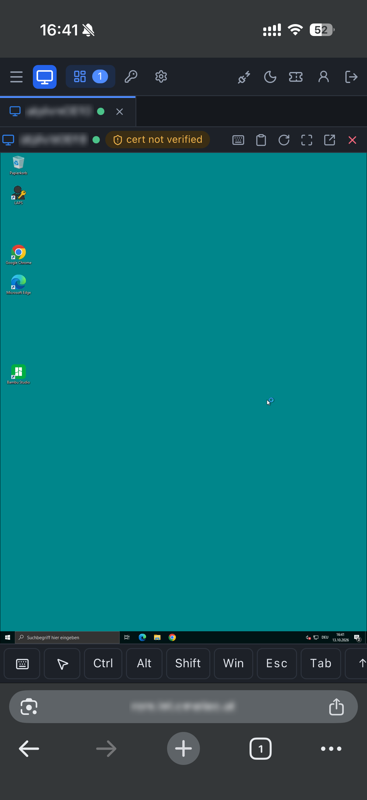

# Remote Connections Manager

[](https://www.paypal.com/donate/?hosted_button_id=U8RDP3XZW4GE4)

Remote Connections Manager is a web-based, self-hosted alternative to desktop remote connection managers. It manages SSH,
SFTP, RDP, VNC, FTP and FTPS connections in a folder tree with inheritance, keeps credentials
encrypted, and runs many simultaneous sessions in tabs, floating windows and split views,
all in the browser.

* **Frontend:** React + TypeScript (Vite), custom window manager, xterm.js, guacamole-common-js
* **Backend:** Python 3.12, FastAPI, SQLAlchemy/asyncpg, asyncssh, ftplib
* **Gateway:** Apache Guacamole **guacd** for RDP/VNC (the Guacamole web application is not used)
* **Database:** external PostgreSQL
* **Auth:** OIDC (Authentik), optional local recovery admin
* **Secrets:** AES-256-GCM at rest; optional sync from OpenBao (Vault-compatible)

## Features

* Folder tree with icons/colours, drag & drop, search, favorites, context menus; display names
  are separate from hostnames
* Parent/child connections: children inherit hostname, credentials and search domain, can
  override any field, and the UI shows where every effective value comes from
* Authentication per connection: inherit, connection-specific, credential store, or ask at launch
  (never stored); field-level credential inheritance
* SSH (native, with host-key trust-on-first-use, jump hosts, resize, auto-reconnect), SFTP/FTP/FTPS
  file manager (drag & drop, folders, progress, rename/move/delete/chmod), RDP and VNC via guacd
  (auto-resize, high-DPI, clipboard, drive redirection, certificate policies, SSH tunnelling)
* Workspace: each session opens as a full-size tab; drag tabs into floating windows
  (move/resize/minimise/maximise) or onto an edge to split; resizable dividers; layout restore
* RBAC (admin / user / read-only + custom roles) with resource ACLs and IdP group mapping
* Credential store with audited reveal, rotation reminders, parent inheritance, OpenBao sync with automatic import
  with explicit conflict handling
* Devolutions RDM import (`.rdm` XML, CSV) with preview, duplicate detection and a report of
  unsupported settings; encrypted passwords are never decrypted
* Versioned REST API with OpenAPI docs, API tokens, idempotency keys, problem+json errors; full audit log

## Screenshots

**Workspace**: connection tree with folders, and the details of the selected connection, including
where each value is inherited from.



**Several sessions at once**: three SSH terminals split in one tab, plus a remote desktop (RDP) in a
floating window.



**Credential store**: shared logins, used by connections without revealing the password.



**On the phone**: SSH and remote desktop with a special-keys bar (Ctrl, Alt, Shift, Win, Esc, Tab,
arrows) above the on-screen keyboard, touchpad-style pointer and pinch zoom.

<p>
  
  &nbsp;
  
</p>

<!-- More screenshots (see docs/screenshots/README.md): add the file, then remove the comment around its line.


-->

## Quick start

```bash
cp .env.example .env                        # set APP_URL, DB_*, OIDC_* (see comments)
echo "ENCRYPTION_KEYS=k1:$(openssl rand -base64 32)"   # → add to .env
docker compose pull && docker compose up -d   # prebuilt images (ghcr.io/cmotec, see IMAGE_PREFIX)
```

No PostgreSQL yet? `docker-compose.postgres.yml` runs everything including a bundled database:
`docker compose -f docker-compose.postgres.yml up -d` (set `DB_PASSWORD` in `.env`).

Then open `APP_URL`. Details: [docs/deployment.md](docs/deployment.md).

`docker-compose.yml` pulls the images (amd64/arm64), which the workflow in `.github/workflows/`
publishes to the GitHub Container Registry or a Gitea registry. `docker-compose.dev.yml` builds them
from this repository instead (`docker compose -f docker-compose.dev.yml up -d --build`). See
[docs/deployment.md](docs/deployment.md#images-and-compose-files).

## Documentation

| Topic | Document |
|---|---|
| Architecture, framework choice, inheritance rules | [docs/architecture.md](docs/architecture.md) |
| guacd integration (handshake, tunnel, security boundaries) | [docs/guacd-integration.md](docs/guacd-integration.md) |
| Database schema | [docs/database-schema.md](docs/database-schema.md) |
| REST API | [docs/api.md](docs/api.md) · [docs/openapi.json](docs/openapi.json) |
| Deployment, Authentik, TLS, upgrades | [docs/deployment.md](docs/deployment.md) |
| Security & threat model | [docs/security.md](docs/security.md) |
| Backup & recovery | [docs/backup-restore.md](docs/backup-restore.md) |
| External secret managers | [docs/secret-providers.md](docs/secret-providers.md) |
| RDM import | [docs/rdm-import.md](docs/rdm-import.md) |
| Testing & acceptance checklist | [docs/testing.md](docs/testing.md) |
| Screenshots (list and guidelines) | [docs/screenshots/](docs/screenshots/README.md) |
| Limitations & risks | [docs/limitations-and-risks.md](docs/limitations-and-risks.md) |

## Development

```bash
# backend (needs Python 3.12)
cd backend && pip install -e ".[test]" && pytest
# run the API locally against your PostgreSQL
ENVIRONMENT=development LOCAL_AUTH_ENABLED=true COOKIE_SECURE=false APP_URL=http://localhost:5173 \
  DB_HOST=… ENCRYPTION_KEYS=k1:… uvicorn app.main:create_app --factory --port 8000

# frontend (Node 22)
cd frontend && npm ci && npm run dev        # http://localhost:5173, proxies /api to :8000
npm test && npm run build

# browser end-to-end tests
see e2e/README.md
```

Repository layout: `backend/` (FastAPI app, Alembic migrations, tests), `frontend/` (SPA, nginx
config), `e2e/` (Playwright smoke tests), `docs/`, and the Compose files at the root.

## Support the project

If Remote Connections Manager is useful to you, you can support its development:

[](https://www.paypal.com/donate/?hosted_button_id=U8RDP3XZW4GE4)

## License

Source-available under the **Apache License 2.0 with the Commons Clause** ([LICENSE](LICENSE)):

* allowed: use (also commercially, e.g. inside your company), modification, and free
  redistribution under the same terms;
* not allowed: selling the software, or a product or service (including paid hosting or support)
  whose value derives entirely or substantially from it.

This is not an OSI-approved open-source license. Third-party components keep their own licenses
(see [NOTICE](NOTICE)).

## Disclaimer

This software is provided **"as is", without warranty of any kind**, express or implied. **Use it at
your own risk.** It handles credentials and opens connections to production systems; review the
configuration and [docs/security.md](docs/security.md) before you rely on it. To the extent
permitted by law, the owner is not liable for any damage or loss arising from the use of, or the
inability to use, this software, including data loss, security incidents, downtime, or damage to
connected systems.